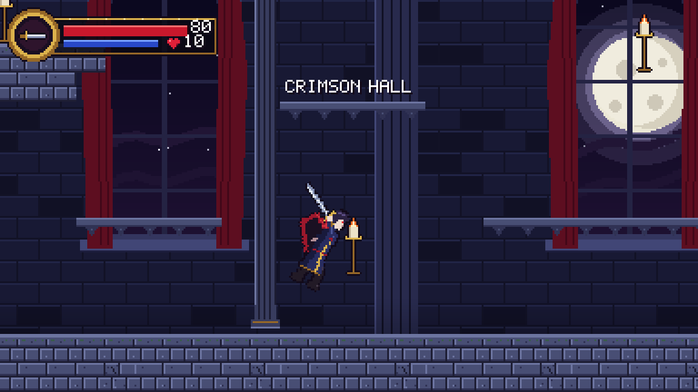
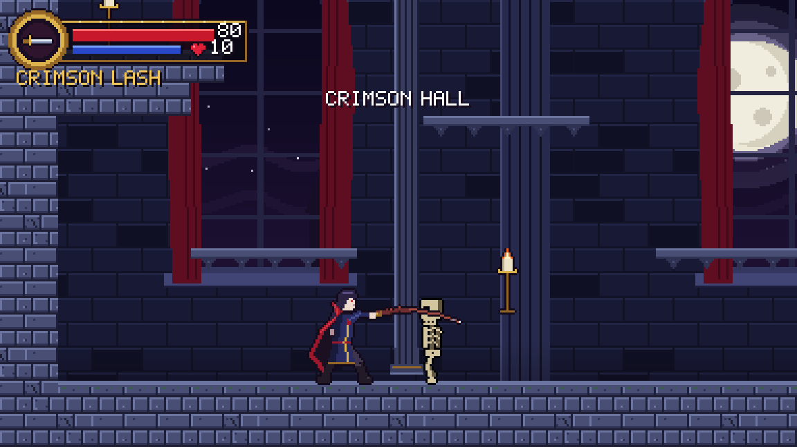
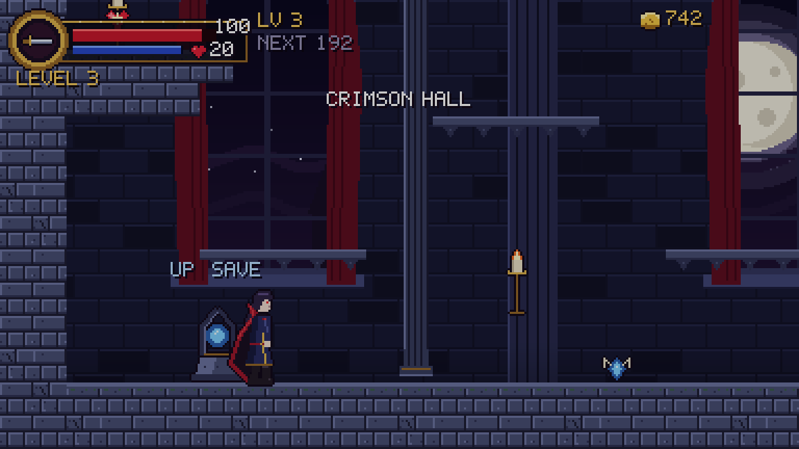
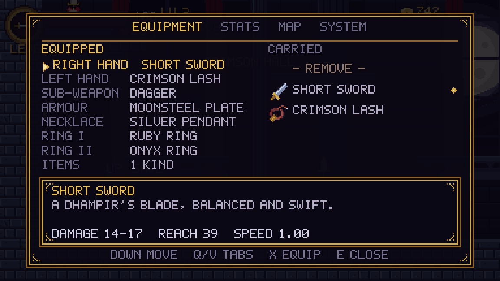
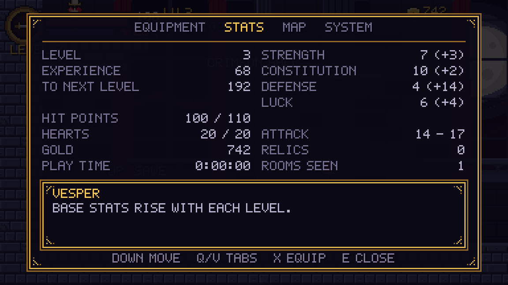

# Crimson Nocturne

A gothic 2D Metroidvania for **Godot 4.7** (GDScript only), in the spirit of
*Castlevania: Symphony of the Night* and the 2D Castlevania games. **Vesper**,
a dhampir swordsman, fights skeletons and bats in the moonlit **Crimson
Hall** — and now levels up, spends hearts, picks up relics, and records the
night at a save shrine.

It implements Phases 0–2 of [`SPEC.md`](SPEC.md): the moveset and combat
prototype, and the persistence and progression layer on top of it. The first
castle wing (Phase 3 — more rooms, a boss, a merchant, the minimap) is next.
Decisions taken where the spec left a blank are logged in
[`ASSUMPTIONS.md`](ASSUMPTIONS.md).

Every asset (sprites, tiles, backgrounds, font, music and SFX) is original and
generated by the Python pipeline in `tools/`, so the project has no
third-party asset licensing to worry about.







---

## Running it

1. Install **Godot 4.7** (standard build; no .NET needed).
2. *Import* this folder in the Project Manager (select `project.godot`).
3. Press **F5**, then choose **New Game**, **Continue**, or **Load Slot**.
   Continue opens the most recently saved readable slot; Load Slot lets you choose.

The renderer is **GL Compatibility**, so it runs on almost any hardware.
The internal resolution is **384×216** (16:9, SotN-era density), scaled
up by integer factors with nearest-neighbour filtering for crisp pixels.

## Controls

| Action              | Keyboard              | Xbox               | PlayStation        |
|---------------------|-----------------------|--------------------|--------------------|
| Move                | WASD / Arrow keys     | D-pad / Left stick | D-pad / Left stick |
| Jump / Double jump  | Space / Z             | A                  | Cross              |
| Attack (main hand)  | X / J                 | X                  | Square             |
| Attack (off hand)   | V / U                 | RB                 | R1                 |
| Sub-weapon          | C / K, or Up + Attack | Y                  | Triangle           |
| Backdash            | Shift / L             | B                  | Circle             |
| Switch sub-weapon   | Q / Tab               | LB                 | L1                 |
| Pause menu          | E / I                 | Back               | Share              |
| Save (at a shrine)  | Up                    | D-pad Up           | D-pad Up           |
| Crouch              | Down                  | Down               | Down               |
| Drop through ledge  | Down + Jump           | Down + A           | Down + Cross       |
| Quick pause         | Esc / P               | Start              | Options            |

*Quick pause* just freezes the game; *Pause menu* opens the full equipment,
stats, chart and system screens. In the menus the bottom face button
(A / Cross) confirms and the right one (B / Circle) backs out, as console
menus do; the shoulder buttons page between tabs.

The double jump is **locked** until you find the Leap Stone, which is lying
on the hall floor a little to the right of where you start.

Remap everything in *Project Settings → Input Map*.

## What's in the box

**Player (Vesper).** An explicit finite state machine with the modern
platformer toolkit: coyote time, jump buffering, variable jump height, heavier
fall gravity, double jump, backdash, crouching, and dropping through one-way
ledges. Melee attacks (standing, crouching, aerial) are driven by frame data.
He carries two weapons — the **Short Sword** (fast, close) and the **Crimson
Lash**, a whip that winds up slower but strikes from half again as far, with
its own swing animations. Heart-powered sub-weapons (Dagger and Axe) have a
heart cost and an on-screen limit. Getting hit gives knockback, stun and
blinking i-frames. HP and MP (with regen) are included.

**Progression.** Enemies grant experience; the curve, the stat gains and the
damage formula are the ones `SPEC.md` specifies. Four stats — Strength,
Constitution, Defense, Luck — drive damage, max HP, damage taken and (later)
drop rates. Equipment layers on top: all flat bonuses are summed, then the
percentage ones are applied to that subtotal, so a ring is never baked into
the saved character sheet. Gold drops from enemies, hearts cap out at a
ceiling that "Heart Max Up" pickups raise, and a level-up heals Vesper to
full, as the classics do.

**Seven equipment slots.** Right hand, left hand, sub-weapon, armour,
necklace and two rings — each one a `Resource`, none of them code. The two
hands are independently swung: *X* for the main one, *V* for the off hand.
The same ring cannot be worn on two fingers; equipping it in the second slot
moves it out of the first.

**Pause menu.** Opened with *E* (or Select) at any time, it pauses the game
and pages between four tabs with the shoulder buttons:

- *Equipment* — the seven slots down the left, everything carried that fits
  the highlighted one down the right, and an info panel reading name,
  description and stats straight off the resource. Provisions (consumables)
  are an eighth row: confirming uses one. Nothing here is authored twice, so a
  new weapon, ring or whole item type appears with no UI changes.
- *Stats* — level, experience, the four stats with what your gear is adding
  in brackets, HP, hearts, gold, and time played.
- *Chart* — the rooms walked so far. The real fog-of-war map arrives with the
  first wing.
- *System* — music and sound volume, screen shake, hit-stop, rumble and which
  brand of button prompts to show.

**Saving.** A shrine stands on the hall floor near the start. Press *Up* in
its light to open a three-slot picker; saving writes the whole run, refills HP
and hearts, and makes that spot where death sends you back to. Death costs
nothing else — no lost experience, gold or items. Saves are JSON under
`user://saves/`, keyed by stable item ids rather than resource paths, so
renaming a `.tres` can never invalidate one. Writes use a verified temporary
file and preserve the previous valid generation as `.bak`; if the primary is
unreadable, loading falls back to that backup. Invalid save structures and
unsupported format versions are rejected before changing the run.

**Controllers.** Xbox, PlayStation, Switch-style and generic pads all *play*
from the one Input Map, because Godot normalises them onto the SDL layout
(button 0 is always the bottom face button, whatever it happens to be printed
as). On top of that the `Controls` autoload adds what the mapping cannot:

- **Prompts that match the hardware.** The pad is identified by USB vendor id,
  falling back to the driver name, so the menu says *SQUARE* on a DualSense and
  *X* on an Xbox pad — the same physical button. Xbox and PlayStation names
  ship; any other pad borrows the Xbox set, and adding a brand (Nintendo's
  swapped A/B, say) is one row per action in `Controls._labels`. Touching the
  keyboard switches the prompts back, and an options menu can pin a set with
  `Controls.force_device`.
- **Sticks read as directions, not speeds.** Past the deadzone means "run", so
  a half-tilted stick does not make Vesper creep out of step with his run
  cycle. Down and Up only count when they beat the horizontal push, which stops
  a stick held down-forward from crouching mid-run or throwing a dagger when
  you meant to swing.
- **Rumble**, requested in the same terms as screen shake (`GameFeel.shake`
  drives both) with a light kick on every hit that lands, scaled by the
  weapon's hit-stop. It has its own switch and strength scale so it can be
  turned down without losing the screen shake, and it is a no-op on keyboard.
- **Hot-plugging.** A pad dying mid-fight pauses the game with
  *CONTROLLER DISCONNECTED* rather than leaving Vesper standing in front of a
  skeleton; plugging one back in and pressing Start resumes.

**Enemies.**
- *Skeleton:* patrols, turns at walls and ledges, and lobs arcing bones when
  you're in range.
- *Bat:* roosts on the ceiling, wakes when you pass underneath, then swoops at
  you in a sine wave.

All enemies share a base class that handles the white hit-flash, knockback,
stun, contact damage, death flames, experience and loot drops. Gold and hearts
roll independently off per-enemy drop tables, and a per-wing
`tier_multiplier` scales an enemy's HP, damage and rewards so the same
resource can staff an early wing and a late one.

**World.** A two-screen tiled room with two parallax layers (a starry sky with
a moon, and a hall wall with arched windows). It also has breakable candles
that drop hearts, enemy spawners with a population budget, a room-clamped
camera with look-ahead and screen shake, a save shrine, and three unique
world items — the Leap Stone, a Heart Max Up on the balcony and a Ruby Ring
on the right-hand ledge. Unique items are taken exactly once for the whole
game: the save file remembers them, so they never respawn.

**Game feel.** Hit-stop, screen shake, damage numbers, pitch-varied SFX, and
an original harpsichord-and-organ looping score, *"Nocturne of the Crimson
Hall"* (D harmonic minor, 138 BPM).

**Flow.** Fade-in, pause, and death, followed by a fade and a respawn at the
last shrine with HP and hearts restored.

---

## Architecture

```
scripts/
  autoload/     Events (signal bus), Audio (SFX pool + music), Controls (pads, prompts,
                rumble), GameFeel (hit-stop, shake, rumble), ItemDB (id -> resource),
                GameManager (the run), SaveManager (slots on disk)
  components/   HealthComponent, Hitbox, Hurtbox  — composable, reused by everything
  combat/       Combat — the damage formula, static and side-effect free
  data/         ItemData and its subclasses: WeaponData, SubWeaponData, ArmorData,
                AccessoryData, ConsumableData, RelicData — Resources, tuned in the Inspector
  progression/  PlayerStats — level, experience and the four base stats
  player/       Player state machine
  enemies/      Enemy base + Skeleton, Bat
  projectiles/  Projectile (straight or arcing)
  pickups/      Pickup (dropped loot), WorldItem (unique, once only)
  world/        Room, RoomCamera, EnemySpawner, Candle, SavePoint
  fx/           OneShotEffect, DamageNumber
  ui/           HUD, PauseMenu, SaveMenu
scenes/         One .tscn per script above; rooms/ holds levels
resources/      .tres data: weapons, sub-weapons, armor, accessories, consumables,
                relics, tileset, SpriteFrames
tools/          Python asset pipeline + level builder (ignored by Godot)
tests/          Headless smoke test + unit tests
```

### Key design decisions

**Composition over inheritance for combat.** Anything that can be hurt has a
`Hurtbox` plus a `HealthComponent`, and anything that deals damage has a
`Hitbox`. A candle, a skeleton and the player all use the same pieces, so new
damageable things need no new combat code.

**Hurtboxes scan and hitboxes are scanned.** Each `Hurtbox` polls its
overlapping hitboxes every physics frame, instead of relying on the one-shot
`area_entered` signal. This means standing inside an enemy keeps hurting you
once your i-frames expire, which is the classic behaviour. A `Hitbox` can hit
each target only once per activation, so one sword swing never multi-hits.

**Decoupling through a signal bus.** The player broadcasts stats on
`Events`, and the HUD, room and camera listen. Gameplay code never holds
references to UI.

**Data-driven content.** Everything Vesper can hold is an `ItemData` `.tres`
file: name, description, icon, price and stat modifiers on the base class,
then whatever the subclass needs — a `WeaponData` adds damage, knockback,
hitbox geometry and the **active frames** of its swing; an `ArmorData` adds
Defense; a `RelicData` adds the ability it unlocks. A new sword, ring or item
category is data, not code, and because the pause menu is built from the
inventory at runtime it appears there with no UI changes.

**Items are identified by id, never by path.** `ItemData.id` is what save
files and (later) shop lists store, and `ItemDB` scans `resources/` at boot to
map ids back to resources, refusing duplicates and blanks loudly. Renaming or
moving a `.tres` therefore cannot invalidate a save.

**The run outlives the player node.** The player scene is destroyed and
rebuilt on every room change and every death, so nothing that must survive is
stored on it. `GameManager` owns level, experience, stats, gold, hearts, the
inventory, the seven equipment slots, collected world items, defeated bosses,
unlocked abilities, explored rooms and the last checkpoint; the player reads
through to it and keeps only what is genuinely physical. `SaveManager` writes
exactly that and nothing else.

**Base stats and effective stats are different things.** `PlayerStats` is the
character sheet a level-up writes to. What combat reads is
`GameManager.get_strength()` and friends, which layer the equipped items on
top — all flat bonuses summed, then the percentages applied to that subtotal.
Equipment can therefore never be baked into a save by accident.

**One damage formula, one place.** `Combat.compute_damage()` is static and
side-effect free, so the unit tests check the curve without a scene, and both
directions — Vesper's swings and everything that hurts him — go through it.
`HealthComponent` applies what it is handed rather than doing arithmetic of
its own.

**Pads are normalised, button names are not.** Godot's SDL mapping means one
Input Map covers every controller, so no code branches per brand — but the
*names* must follow the hardware, or a PlayStation player is told to press a
button that isn't there. So prompts are the only device-aware thing in the
game, resolved through `Controls.get_action_label()`, and nothing else has to
care what is plugged in.

**Analog input is interpreted where it is used.** `Controls` deliberately does
not wrap the sticks: what a tilt *means* is a gameplay decision, so it lives in
`Player._move_input()` / `_is_holding_down()` next to the movement it drives.
Deadzones stay in the Input Map (0.3 horizontal so a modest push runs, 0.5
vertical so diagonals do not read as crouch).

**Physics layers.** These are named in *Project Settings → Layer Names* and
used consistently everywhere:

| # | Name            | Who is on it                           |
|---|-----------------|----------------------------------------|
| 1 | world           | Solid tiles                            |
| 2 | player          | Player body                            |
| 3 | enemy           | Enemy bodies (they don't block the player) |
| 4 | player_hurtbox  | Player hurtbox (scans layer 7)         |
| 5 | enemy_hurtbox   | Enemy and candle hurtboxes (scan layer 6) |
| 6 | player_attack   | Sword, whip, dagger, axe hitboxes      |
| 7 | enemy_attack    | Contact damage, bones                  |
| 8 | pickup          | Hearts, gold                           |
| 9 | one_way         | Drop-through ledges                    |

**Hit-stop uses a real-time deadline.** Overlapping hit-stops extend the
deadline, and time scale can never get stuck in slow motion. This was a real
bug found by the smoke test.

**Pause.** `Main` runs with `PROCESS_MODE_ALWAYS`, and the `World` and `HUD`
branches are explicitly `PAUSABLE`. Music keeps playing while paused. The
pause and save menus are modal: each pauses the tree itself and marks every
input it sees as handled, so nothing leaks into gameplay and `Main` leaves the
pause button alone while one is up.

---

## Extending the game

Every item type below needs a unique `id` — it is what saves and shops store.
`ItemDB` scans `resources/` at boot and will shout in the console if two items
share one or if one is blank.

### Add a weapon
1. Right-click `resources/weapons/` → *New Resource* → `WeaponData`.
2. Give it an `id`, a `display_name`, a `description`, an `icon` and a `price`,
   then set damage, knockback, hitbox size/offset and `active_frames` (the
   attack animation frames where the hitbox is live). Any stat modifiers go in
   the *Stat Modifiers* group it inherits from `ItemData`.
3. Leave `attack_animation` at `attack` to reuse the sword swing. A weapon with
   its own silhouette (as the whip has) needs `<name>`, `<name>_crouch` and
   `<name>_air` rows added to `tools/asset_pipeline/hero.py`; re-running it
   regenerates the sheet and the `SpriteFrames` resource. The player falls back
   to the sword animations, with a warning, if a variant is missing.
4. Put it in the world (see *Add a world item*) or, to start the game with it,
   append it to `Player.starting_loadout` in `scenes/player/player.tscn`. Either
   way it shows up in the pause menu with no UI changes.

### Add a sub-weapon
1. Duplicate `scenes/projectiles/axe.tscn`. Set straight flight with `speed`,
   or an arc with `launch_velocity` + `gravity_scale`. Configure the child
   `Hitbox` (layer 6).
2. Create a `SubWeaponData` resource pointing at the scene, with an `id`, icon,
   heart cost, cooldown and max active count. Give it a `damage` to override the
   projectile scene's own, so one scene can serve a starter dagger and a
   late-game one.
3. Place it in the world, or add it to `Player.starting_loadout`.

### Add armour, a necklace, a ring or a potion
1. New `Resource` in `resources/armor/`, `resources/accessories/` or
   `resources/consumables/`, of type `ArmorData`, `AccessoryData` or
   `ConsumableData`.
2. Fill in the `ItemData` fields, then the type's own: `defense` for armour,
   `slot` (Necklace or Ring) for an accessory, `heal_amount` / `heart_amount`
   for a consumable.
3. Flat and percentage stat modifiers live on `ItemData` and work on any of
   them. They only count while the item is equipped.

### Add a relic that unlocks a move
1. New `RelicData` in `resources/relics/`, with the `ability` id it grants —
   `GameManager.ABILITY_DOUBLE_JUMP`, for instance.
2. Gate the move on `GameManager.has_ability(...)`, the way
   `Player.can_double_jump()` does.
3. Place it in the world. Picking it up unlocks the ability permanently, and
   the unlock is saved.

### Add a world item
Instance `scenes/pickups/world_item.tscn` into a room and set:
- `world_item_id` — **unique across the whole game**. It is what the save file
  remembers; two items sharing one would make taking either delete both.
- `grant` — *Item* (hand over `item`), *Heart Max Up* (raise the ceiling by
  `amount`) or *Gold*.
- `icon_override` if there is no `item` to take the icon from.

### Add a save room
Instance `scenes/world/save_point.tscn` into the room and make sure the room's
`room_id` is set — that is what the checkpoint is filed under, so the save
survives the room being rebuilt around it.

### Add an enemy
1. Create a script that `extends Enemy` and override `_ai_process(delta)`. Use
   `_on_hurt(hitbox)` for reactions such as interrupting attacks.
2. Build a scene with the required children: `Sprite` (AnimatedSprite2D with
   the hit-flash `ShaderMaterial`, **local to scene**), `HealthComponent`,
   `Hurtbox` (layer 5, mask 6) and `ContactHitbox` (layer 7). Copy
   `scenes/enemies/skeleton.tscn` as a template.
3. Point an `EnemySpawner` at it, or place it directly in a room.

### Add a room
- **In the editor:** duplicate `scenes/rooms/castle_hall.tscn`, repaint the
  `Tiles` (collision) and `Decor` layers, then set `size_in_tiles` on the root
  `Room` so the camera clamps correctly.
- **From ASCII:** copy `tools/level_builder/build_castle_hall.py`, edit the
  layout strings and spawn lists, and run it. Re-running overwrites editor
  changes, so treat it as a bootstrap.
- Give the root `Room` a unique `room_id`. It is what the map's fog of war and
  the checkpoint are filed under.
- **Next milestone for a full Metroidvania:** door/transition areas that call a
  room-loader autoload. The save layer underneath is already in place —
  `GameManager` records explored rooms, defeated bosses, collected world items
  and unlocked abilities, and `SaveManager` persists all of it.

---

## Asset pipeline

```bash
pip install pillow numpy scipy      # ffmpeg with libvorbis is needed for the music
python3 tools/asset_pipeline/build_all.py         # regenerate all art & audio
python3 tools/level_builder/build_castle_hall.py  # regenerate the room scene
```

| Script           | Produces |
|------------------|----------|
| `common.py`      | Shared palette, drawing helpers, and `SheetBuilder` (packs frames and writes Godot `SpriteFrames` .tres files) |
| `hero.py`        | Vesper, rendered from a 2D skeleton rig (15 animations, 128×64 frames) |
| `sprites_misc.py`| Skeleton, bat, effects, candle, items, weapon icons, HUD and menu chrome |
| `equipment.py`   | Armour, necklace and ring icons, potion, Leap Stone, Heart Max Up, spinning gold coin, and the save shrine |
| `environment.py` | 16px tileset, sky and hall parallax layers, 5×7 bitmap font (BMFont) |
| `audio.py`       | Music loop (harpsichord, organ, bass, drums, cathedral reverb) and 18 SFX |

The art direction follows SotN: dark blue-violet stone, crimson accents,
candle-gold trims, 1px dark outlines, and a bright foreground against a muted
background.

## Testing

```bash
godot --headless --path . res://tests/unit_test.tscn    # logic
godot --headless --path . res://tests/smoke_test.tscn   # the game itself
```

The suites exit 0 on success and use isolated test-save directories.
The scene harnesses include watchdogs to prevent a script error from hanging CI.

**`unit_test.tscn`** checks the things that are pure arithmetic and would be
miserable to verify by playing: the damage formula (both sides, the minimum of
1, and that 400 rolls stay inside the ±10% band), the experience curve and
multi-level awards, how equipment layers onto base stats, the equipment rules
(you cannot wear one ring twice, a sword does not fit the armour slot), gold
that refuses to go negative, drop-chance distributions, and the save/load
round trip — in memory and on disk, field by field, plus a corrupt file and a
save written by an older build. Disk tests use a separate test directory.

**`smoke_test.tscn`** boots the game and drives the player with simulated
input: landing, running, jumping, attacking with both hands, sub-weapons and
cycling, backdash, crouching (and that the hurtbox shrinks with it), enemy
spawning and death, hit-stop recovery, damage through the formula and
i-frames. It opens the pause menu, equips the whip through it, and proves the
whip reaches a target the sword falls short of; kills an enemy and checks the
experience and gold land; levels Vesper up and checks the heal; walks onto the
Leap Stone and checks the double jump unlocks and stays unlocked; and saves at
the shrine, reloads the slot, and respawns on it. Controller support is covered
by feeding the engine synthetic pad events: the prompts switch device, the face
button jumps, the left stick runs, a stick held down-forward does not crouch,
the menu names the pad's buttons and backs out with B / Circle, and losing the
pad pauses the game.

**Regression checks** cover malformed saves, failed writes and backup recovery,
loaded equipment invariants, posthumous level-ups, projectile impacts, and the
title-screen slot picker:

```bash
godot --headless --path . res://tests/regression_test.tscn
# Run these sequentially to verify persistence across application processes:
godot --headless --path . res://tests/cold_start_test.tscn -- --prepare
godot --headless --path . res://tests/cold_start_test.tscn -- --continue
godot --headless --path . res://tests/cold_start_test.tscn -- --new-game
```

## Known limitations and next steps

Roughly in the order `SPEC.md` wants them. Phases 0–2 are done; this is what
Phase 3 (the first castle wing) still needs:

- **One room.** Door/transition areas and a room-loader autoload are the next
  real piece of work. Everything underneath — room ids, explored-room tracking,
  checkpoints — is in place and saved.
- **No minimap or map screen.** The *Chart* tab lists the rooms walked rather
  than drawing them, because with one room there is nothing to draw. Save and
  boss room icons come with it.
- **No boss and no merchant.** `GameManager.defeated_bosses` and the gold
  economy (prices on every item, `spend_gold()` that refuses to overdraw) are
  waiting for them.
- **The ability gate is not gating anything yet.** The double jump genuinely
  starts locked and the Leap Stone genuinely unlocks it, but the relic sits on
  the open floor — a properly inaccessible area needs more than one room.
- **No runtime key rebinding.** Deferred to Phase 4, as the spec permits; the
  *System* tab points at *Project Settings → Input Map* meanwhile. Every action
  already goes through a named Input Map action, so adding the screen later
  needs no gameplay changes.
- **MP is unused.** It predates the spec, which never mentions it. Left alone
  and reserved for spells or familiars.

See [`ASSUMPTIONS.md`](ASSUMPTIONS.md) for the numbers and formats chosen where
the spec left a blank, and for the two places this project knowingly deviates
from it.
