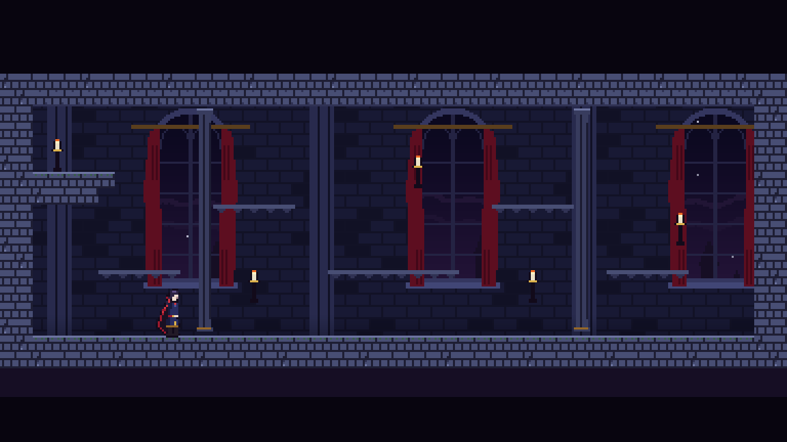

# Crimson Nocturne

A gothic 2D Metroidvania starter project for **Godot 4.7** (GDScript only),
in the spirit of *Castlevania: Symphony of the Night* and the 2D Castlevania
games. It is one fully playable room: **Vesper**, a dhampir swordsman, fights
endlessly respawning skeletons and bats in the moonlit **Crimson Hall**.

Every asset (sprites, tiles, backgrounds, font, music and SFX) is original and
generated by the Python pipeline in `tools/`, so the project has no
third-party asset licensing to worry about.




---

## Running it

1. Install **Godot 4.7** (standard build; no .NET needed).
2. *Import* this folder in the Project Manager (select `project.godot`).
3. Press **F5**.

The renderer is **GL Compatibility**, so it runs on almost any hardware.
The internal resolution is **384×216** (16:9, SotN-era density), scaled
up by integer factors with nearest-neighbour filtering for crisp pixels.

## Controls

| Action              | Keyboard              | Gamepad            |
|---------------------|-----------------------|--------------------|
| Move                | WASD / Arrow keys     | D-pad / Left stick |
| Jump / Double jump  | Space / Z             | A (bottom)         |
| Attack              | X / J                 | X (left)           |
| Sub-weapon          | C / K, or Up + Attack | Y (top)            |
| Backdash            | Shift / L             | B (right)          |
| Switch sub-weapon   | Q / Tab               | LB / RB            |
| Crouch              | Down                  | Down               |
| Drop through ledge  | Down + Jump           | Down + A           |
| Pause               | Esc / P               | Start              |

Remap everything in *Project Settings → Input Map*.

## What's in the box

**Player (Vesper).** An explicit finite state machine with the modern
platformer toolkit: coyote time, jump buffering, variable jump height, heavier
fall gravity, double jump, backdash, crouching, and dropping through one-way
ledges. Melee attacks (standing, crouching, aerial) are driven by frame data.
Heart-powered sub-weapons (Dagger and Axe) have a heart cost and an
on-screen limit. Getting hit gives knockback, stun and blinking i-frames. HP
and MP (with regen) are included.

**Enemies.**
- *Skeleton:* patrols, turns at walls and ledges, and lobs arcing bones when
  you're in range.
- *Bat:* roosts on the ceiling, wakes when you pass underneath, then swoops at
  you in a sine wave.

All enemies share a base class that handles the white hit-flash, knockback,
stun, contact damage, death flames and loot drops.

**World.** A two-screen tiled room with two parallax layers (a starry sky with
a moon, and a hall wall with arched windows). It also has breakable candles
that drop hearts, enemy spawners with a population budget, and a
room-clamped camera with look-ahead and screen shake.

**Game feel.** Hit-stop, screen shake, damage numbers, pitch-varied SFX, and
an original harpsichord-and-organ looping score, *"Nocturne of the Crimson
Hall"* (D harmonic minor, 138 BPM).

**Flow.** Fade-in, pause, and death, followed by a fade and a room reload.

---

## Architecture

```
scripts/
  autoload/     Events (signal bus), Audio (SFX pool + music), GameFeel (hit-stop, shake)
  components/   HealthComponent, Hitbox, Hurtbox  — composable, reused by everything
  data/         WeaponData, SubWeaponData          — Resources, tuned in the Inspector
  player/       Player state machine
  enemies/      Enemy base + Skeleton, Bat
  projectiles/  Projectile (straight or arcing)
  pickups/      Pickup (hearts / health)
  world/        Room, RoomCamera, EnemySpawner, Candle
  fx/           OneShotEffect, DamageNumber
  ui/           HUD
scenes/         One .tscn per script above; rooms/ holds levels
resources/      .tres data: weapons, sub-weapons, tileset, SpriteFrames
tools/          Python asset pipeline + level builder (ignored by Godot)
tests/          Headless smoke test
```

### Key design decisions

**Composition over inheritance for combat.** Anything that can be hurt has a
`Hurtbox` plus a `HealthComponent`, and anything that deals damage has a
`Hitbox`. A candle, a skeleton and the player all use the same pieces, so new
damageable things need no new combat code.

**Hurtboxes scan and hitboxes are scanned.** Each `Hurtbox` polls its
overlapping hitboxes every physics frame, instead of relying on the one-shot
`area_entered` signal. This means standing inside an enemy keeps hurting you
once your i-frames expire, which is the classic behaviour. A `Hitbox` can hit
each target only once per activation, so one sword swing never multi-hits.

**Decoupling through a signal bus.** The player broadcasts stats on
`Events`, and the HUD, room and camera listen. Gameplay code never holds
references to UI.

**Data-driven weapons.** A `WeaponData` resource defines damage, knockback,
hitbox geometry and the **active frames** of the swing animation. A new sword
is a new `.tres` file, not new code.

**Physics layers.** These are named in *Project Settings → Layer Names* and
used consistently everywhere:

| # | Name            | Who is on it                           |
|---|-----------------|----------------------------------------|
| 1 | world           | Solid tiles                            |
| 2 | player          | Player body                            |
| 3 | enemy           | Enemy bodies (they don't block the player) |
| 4 | player_hurtbox  | Player hurtbox (scans layer 7)         |
| 5 | enemy_hurtbox   | Enemy and candle hurtboxes (scan layer 6) |
| 6 | player_attack   | Sword, dagger, axe hitboxes            |
| 7 | enemy_attack    | Contact damage, bones                  |
| 8 | pickup          | Hearts                                 |
| 9 | one_way         | Drop-through ledges                    |

**Hit-stop uses a real-time deadline.** Overlapping hit-stops extend the
deadline, and time scale can never get stuck in slow motion. This was a real
bug found by the smoke test.

**Pause.** `Main` runs with `PROCESS_MODE_ALWAYS`, and the `World` and `HUD`
branches are explicitly `PAUSABLE`. Music keeps playing while paused.

---

## Extending the game

### Add a weapon
1. Right-click `resources/weapons/` → *New Resource* → `WeaponData`.
2. Set damage, knockback, hitbox size/offset and `active_frames` (the attack
   animation frames where the hitbox is live).
3. Assign it to `Player.weapon`. An equipment/inventory system would swap this
   at runtime.

### Add a sub-weapon
1. Duplicate `scenes/projectiles/axe.tscn`. Set straight flight with `speed`,
   or an arc with `launch_velocity` + `gravity_scale`. Configure the child
   `Hitbox` (layer 6).
2. Create a `SubWeaponData` resource pointing at the scene, with an icon, heart
   cost and max active count.
3. Append it to `Player.subweapons`.

### Add an enemy
1. Create a script that `extends Enemy` and override `_ai_process(delta)`. Use
   `_on_hurt(hitbox)` for reactions such as interrupting attacks.
2. Build a scene with the required children: `Sprite` (AnimatedSprite2D with
   the hit-flash `ShaderMaterial`, **local to scene**), `HealthComponent`,
   `Hurtbox` (layer 5, mask 6) and `ContactHitbox` (layer 7). Copy
   `scenes/enemies/skeleton.tscn` as a template.
3. Point an `EnemySpawner` at it, or place it directly in a room.

### Add a room
- **In the editor:** duplicate `scenes/rooms/castle_hall.tscn`, repaint the
  `Tiles` (collision) and `Decor` layers, then set `size_in_tiles` on the root
  `Room` so the camera clamps correctly.
- **From ASCII:** copy `tools/level_builder/build_castle_hall.py`, edit the
  layout strings and spawn lists, and run it. Re-running overwrites editor
  changes, so treat it as a bootstrap.
- **Next milestone for a full Metroidvania:** add door/transition areas
  that call a scene loader autoload, plus a save-data autoload for
  unlocked abilities and a map. The player already exposes ability flags such
  as `can_double_jump` for gating.

---

## Asset pipeline

```bash
pip install pillow numpy scipy      # ffmpeg with libvorbis is needed for the music
python3 tools/asset_pipeline/build_all.py         # regenerate all art & audio
python3 tools/level_builder/build_castle_hall.py  # regenerate the room scene
```

| Script           | Produces |
|------------------|----------|
| `common.py`      | Shared palette, drawing helpers, and `SheetBuilder` (packs frames and writes Godot `SpriteFrames` .tres files) |
| `hero.py`        | Vesper, rendered from a 2D skeleton rig (12 animations, 96×64 frames) |
| `sprites_misc.py`| Skeleton, bat, effects, candle, items, HUD pieces |
| `environment.py` | 16px tileset, sky and hall parallax layers, 5×7 bitmap font (BMFont) |
| `audio.py`       | Music loop (harpsichord, organ, bass, drums, cathedral reverb) and 15 SFX |

The art direction follows SotN: dark blue-violet stone, crimson accents,
candle-gold trims, 1px dark outlines, and a bright foreground against a muted
background.

## Testing

```bash
godot --headless --path . res://tests/smoke_test.tscn   # exit code 0 = pass
```

The test boots the game, drives the player with simulated input, and checks
landing, running, jumping, attacking, sub-weapons and cycling, backdash,
enemy spawning and death, hit-stop recovery, damage and i-frames. It is
suitable for CI.

## Known limitations and next steps

- The player's hurtbox doesn't shrink while crouching. Resize it in
  `_set_crouch_shape` if you want crouching to dodge projectiles.
- Enemies don't grant experience yet. `Enemy.experience` is present, and
  `Events.enemy_killed` is ready for a leveling system.
- There's no settings menu. `GameFeel.hit_stop_enabled` and
  `screen_shake_enabled` are ready to be exposed as accessibility options.
